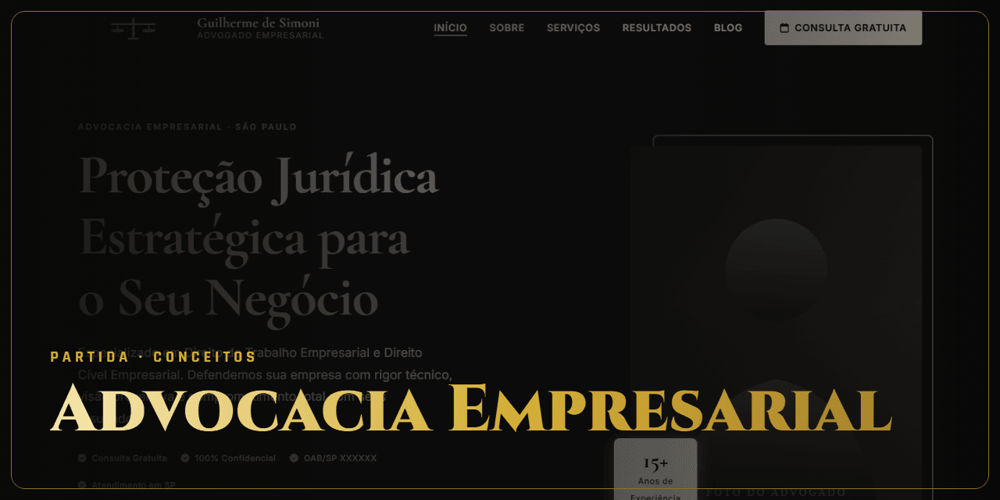

<!-- Gerado por github-perfil. Não editar à mão. -->

# Advocacia Empresarial

**Análise · Conceito** · Conceitos · Conceito

Modelo de site institucional para escritório de advocacia.

### Lances principais

- Tema WordPress próprio
- Ambiente Docker

### Stack

`WordPress` `PHP` `Sass` `Gulp` `Docker`

### Onde ver

Demonstração em revisão.

---

🔒 **Código privado.** Este repositório apresenta o projeto, sem o código-fonte. Veja os [termos de uso](NOTICE.md).

[← Voltar ao perfil](https://github.com/ViniciusDev-git)

<b>English</b>

## Advocacia Empresarial

**Análise · Concept** · Concepts

Corporate website template for a law firm.

- Custom WordPress theme
- Docker environment

**Stack:** WordPress, PHP, Sass, Gulp, Docker

**Where to see it:** Demo under review.

Source code is private. This repository presents the project without its source.

