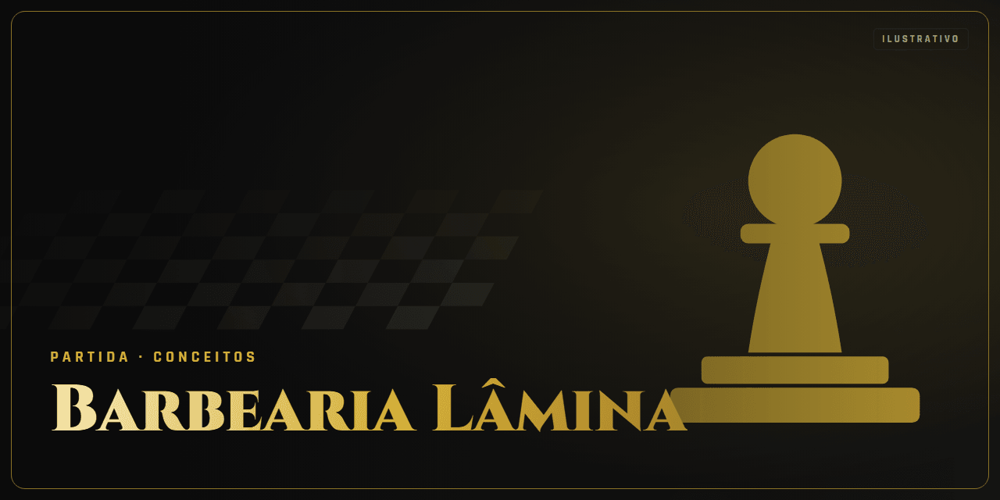

<!-- Gerado por github-perfil. Não editar à mão. -->

# Barbearia Lâmina

**Análise · Conceito** · Conceitos · Conceito

Site one-page com agendamento, construído de ponta a ponta pelo Estúdio Digital.

### Lances principais

- Tema WordPress com ACF
- Gerado pelo fluxo de agentes

### Stack

`WordPress` `ACF` `Docker`

### Onde ver

Projeto sem página pública.

---

🔒 **Código privado.** Este repositório apresenta o projeto, sem o código-fonte. Veja os [termos de uso](NOTICE.md).

[← Voltar ao perfil](https://github.com/ViniciusDev-git)

<b>English</b>

## Barbearia Lâmina

**Análise · Concept** · Concepts

One-page site with booking, built end to end by the Digital Studio.

- WordPress theme with ACF
- Produced by the agent workflow

**Stack:** WordPress, ACF, Docker

**Where to see it:** No public page.

Source code is private. This repository presents the project without its source.

