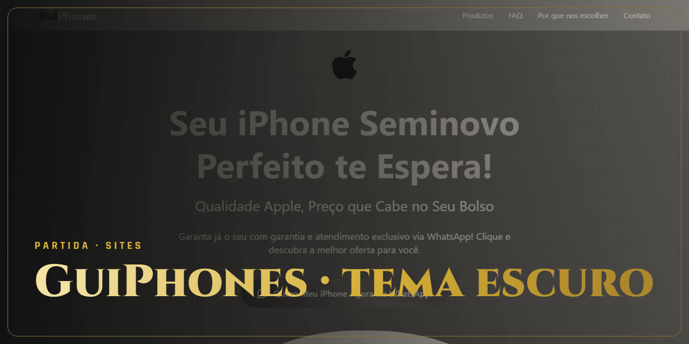

<!-- Gerado por github-perfil. Não editar à mão. -->

# GuiPhones · tema escuro

**Vitória · Entregue** · Sites e e-commerce · GuiPhones

Landing page de iPhones seminovos com conversão pelo WhatsApp, versão de tema escuro.

### Lances principais

- Animações de entrada
- Botão fixo de WhatsApp

### Stack

`React` `Vite` `Tailwind CSS` `Framer Motion`

### Onde ver

[Ver no ar](https://guiphones.vercel.app)

---

🔒 **Código privado.** Este repositório apresenta o projeto, sem o código-fonte. Veja os [termos de uso](NOTICE.md).

[← Voltar ao perfil](https://github.com/ViniciusDev-git)

<b>English</b>

## GuiPhones · tema escuro

**Vitória · Delivered** · Websites and e-commerce

Landing page for refurbished iPhones with WhatsApp conversion, dark theme.

- Entrance animations
- Sticky WhatsApp button

**Stack:** React, Vite, Tailwind CSS, Framer Motion

**Where to see it:** [Live](https://guiphones.vercel.app)

Source code is private. This repository presents the project without its source.

