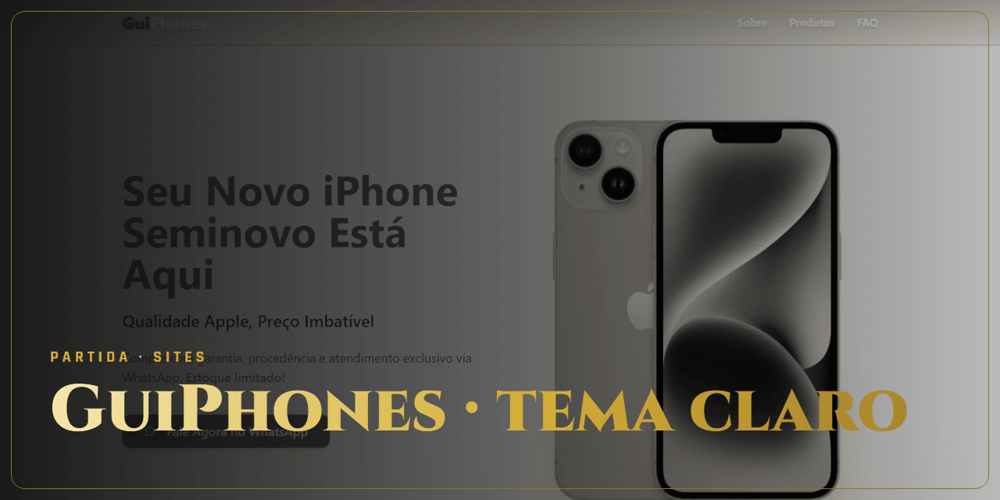

<!-- Gerado por github-perfil. Não editar à mão. -->

# GuiPhones · tema claro

**Vitória · Entregue** · Sites e e-commerce · GuiPhones

Segunda versão da landing page, desenvolvida do zero em tema claro.

### Lances principais

- SEO com sitemap e dados sociais
- Componentes shadcn/ui

### Stack

`React` `TypeScript` `Vite` `Tailwind CSS`

### Onde ver

[Ver no ar](https://guiphoneslight.vercel.app)

---

🔒 **Código privado.** Este repositório apresenta o projeto, sem o código-fonte. Veja os [termos de uso](NOTICE.md).

[← Voltar ao perfil](https://github.com/ViniciusDev-git)

<b>English</b>

## GuiPhones · tema claro

**Vitória · Delivered** · Websites and e-commerce

Second version of the landing page, rebuilt from scratch in a light theme.

- SEO with sitemap and social metadata
- shadcn/ui components

**Stack:** React, TypeScript, Vite, Tailwind CSS

**Where to see it:** [Live](https://guiphoneslight.vercel.app)

Source code is private. This repository presents the project without its source.

