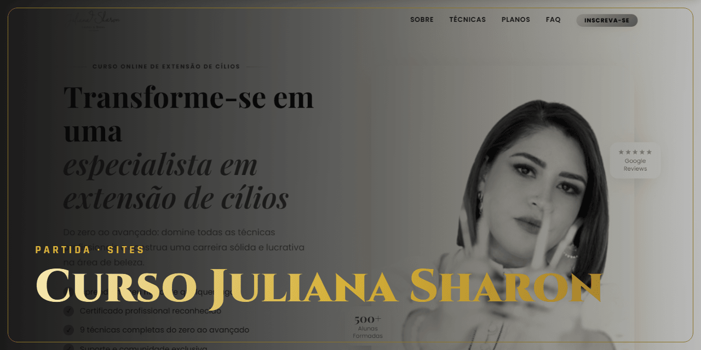

<!-- Gerado por github-perfil. Não editar à mão. -->

# Curso Juliana Sharon

**Vitória · Entregue** · Sites e e-commerce · Juliana Sharon

Landing page de venda de curso de extensão de cílios.

### Lances principais

- 13 seções de venda
- Versão WordPress e versão estática

### Stack

`WordPress` `HTML` `CSS` `Docker`

### Onde ver

[Ver no ar](https://juliana-sharon-curso.vercel.app)

---

🔒 **Código privado.** Este repositório apresenta o projeto, sem o código-fonte. Veja os [termos de uso](NOTICE.md).

[← Voltar ao perfil](https://github.com/ViniciusDev-git)

<b>English</b>

## Curso Juliana Sharon

**Vitória · Delivered** · Websites and e-commerce

Sales landing page for an eyelash extension course.

- 13 sales sections
- WordPress and static versions

**Stack:** WordPress, HTML, CSS, Docker

**Where to see it:** [Live](https://juliana-sharon-curso.vercel.app)

Source code is private. This repository presents the project without its source.

