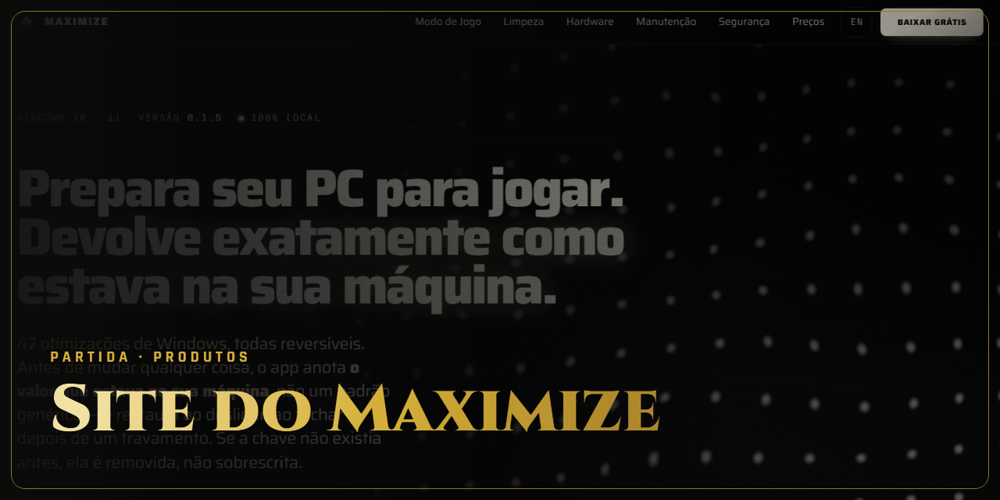

<!-- Gerado por github-perfil. Não editar à mão. -->

# Site do Maximize

**Em jogo · Em andamento** · Produtos · Produto próprio

Site institucional e landing page bilíngues do Maximize.

### Lances principais

- 12 páginas em português e 12 em inglês
- Landing page de campanha

### Stack

`HTML` `CSS` `JavaScript` `WordPress` `Docker`

### Onde ver

Projeto sem página pública.

---

🔒 **Código privado.** Este repositório apresenta o projeto, sem o código-fonte. Veja os [termos de uso](NOTICE.md).

[← Voltar ao perfil](https://github.com/ViniciusDev-git)

<b>English</b>

## Site do Maximize

**Em jogo · In progress** · Products

Bilingual website and landing page for Maximize.

- 12 pages in Portuguese and 12 in English
- Campaign landing page

**Stack:** HTML, CSS, JavaScript, WordPress, Docker

**Where to see it:** No public page.

Source code is private. This repository presents the project without its source.

