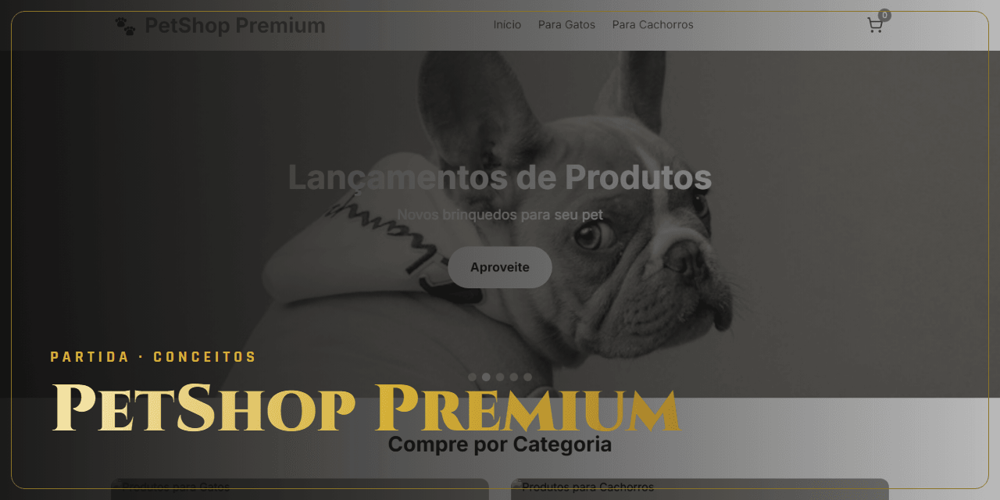

<!-- Gerado por github-perfil. Não editar à mão. -->

# PetShop Premium

**Adiada · Pausado** · Conceitos · Conceito

Loja demonstrativa para pet shop, com catálogo por categoria, serviços e checkout.

### Lances principais

- 7 páginas
- Interface em React com shadcn/ui

### Stack

`React` `TypeScript` `Vite` `Tailwind CSS`

### Onde ver

[Ver no ar](https://petshop-umber.vercel.app)

---

🔒 **Código privado.** Este repositório apresenta o projeto, sem o código-fonte. Veja os [termos de uso](NOTICE.md).

[← Voltar ao perfil](https://github.com/ViniciusDev-git)

<b>English</b>

## PetShop Premium

**Adiada · Paused** · Concepts

Demo pet shop store with category catalog, services and checkout.

- 7 pages
- React UI with shadcn/ui

**Stack:** React, TypeScript, Vite, Tailwind CSS

**Where to see it:** [Live](https://petshop-umber.vercel.app)

Source code is private. This repository presents the project without its source.

